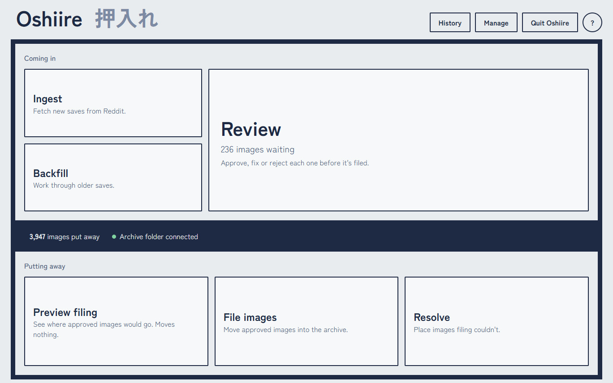
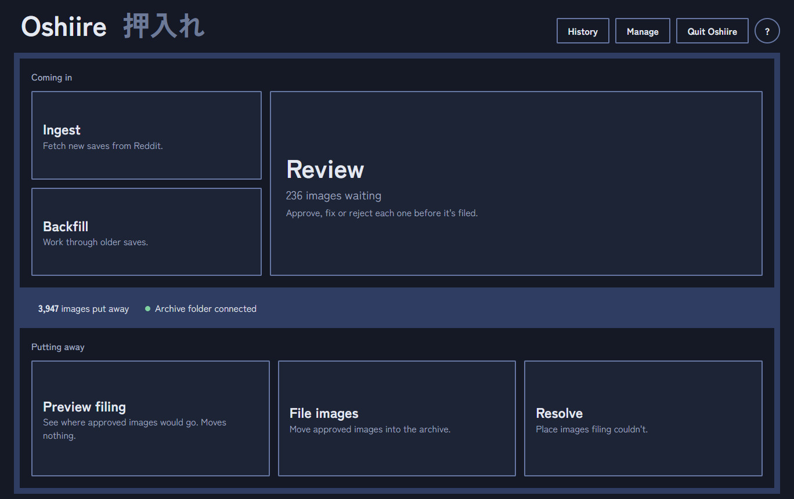
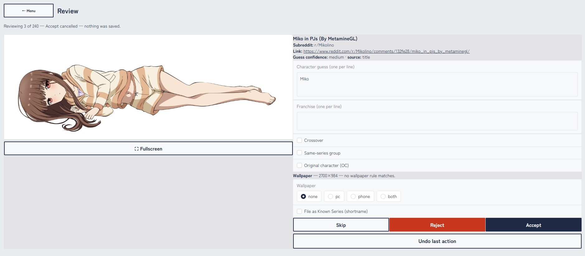
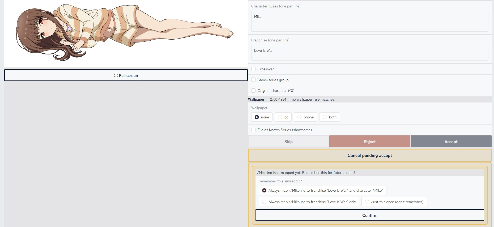
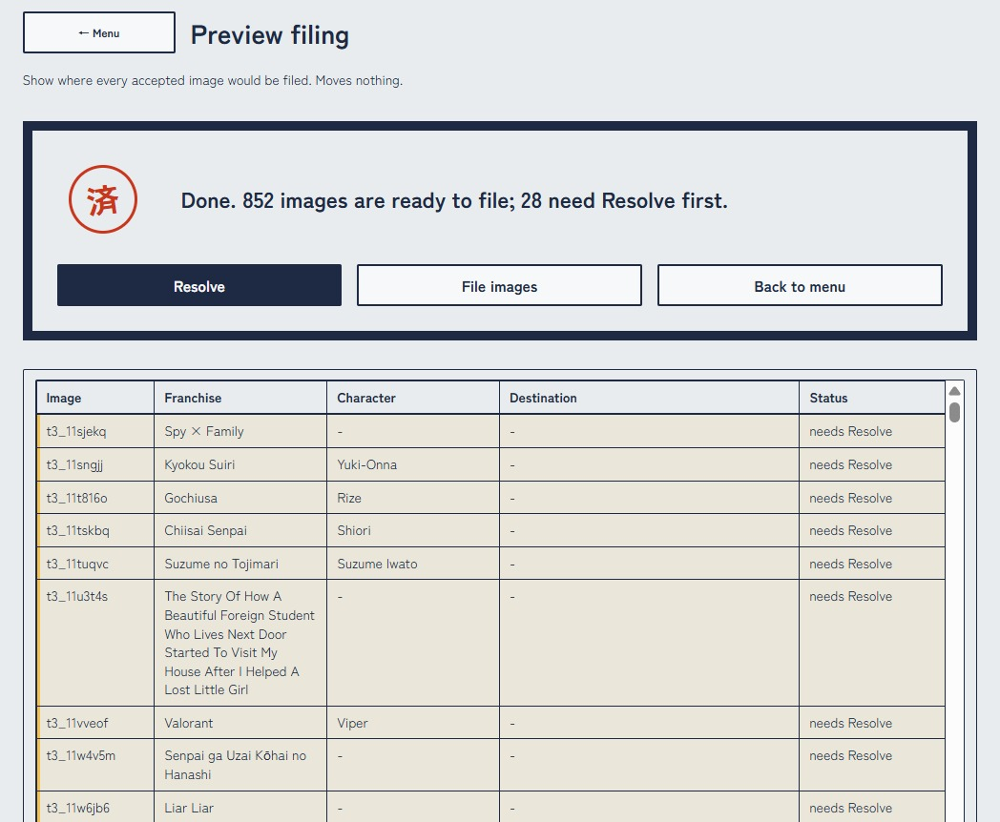
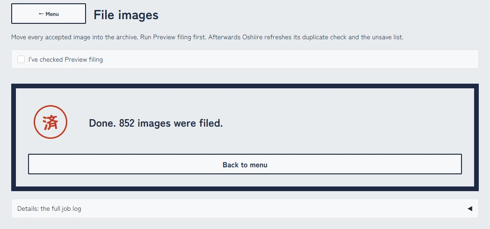
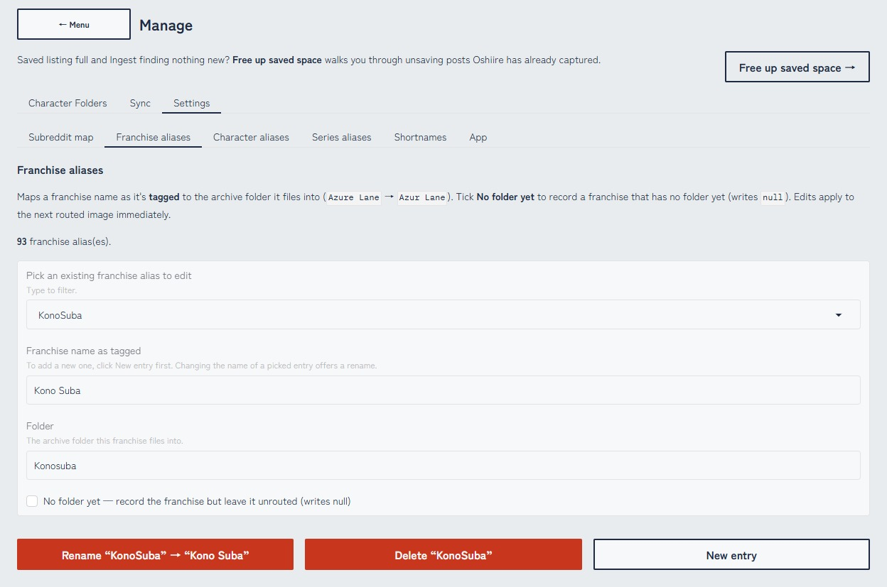
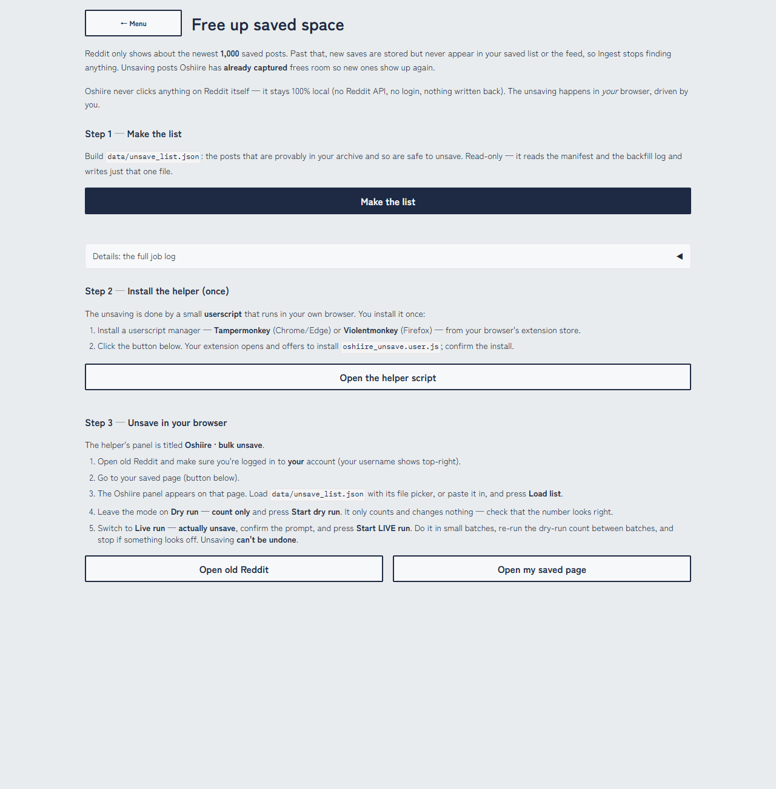

# Oshiire

A local, single-user pipeline that archives saved anime-style artwork from a
Reddit account. It reads a private Reddit "saved" RSS feed, downloads the
images, guesses the character(s) via post metadata and a local AI tagger as a
fallback, and presents each image in a small web UI for human approve/edit/
reject before filing it into a sorted personal archive.

Everything runs locally. No image, title, or metadata is ever sent to a third
party — the only outbound network calls are to Reddit itself (to read the
feed, fetch post pages, and download images).

**Setup & usage:** see [docs/SETUP.md](docs/SETUP.md).
**Reaching saves the RSS feed can't see:** see [docs/BACKFILL.md](docs/BACKFILL.md).

## Using it

It's **one app**. Double-click **`Oshiire.bat`** (Windows) or **`oshiire.sh`**
(Linux/macOS) and it opens in your **web browser** by default. Prefer its own
window instead, or set Light / Dark / Match system, under **Manage → Settings →
App** (stored in `data/settings.json`). In browser mode, **Quit Oshiire** in the
header stops it; in a window, closing the window quits. A second double-click
while it's already running just opens another tab (browser) or focuses the
window.

Everything is driven from the **home menu**, no terminal:

- **Coming in** — **Ingest** (fetch new saves from your feed), **Backfill**
  (work through older saves from the data export, a batch at a time, with a
  Stop button), and the big **Review** door (approve / fix / reject each image
  before it's filed). AI tagging runs automatically at the end of Ingest and
  Backfill.
- **Putting away** — **Preview filing** (show where every accepted image would
  go; moves nothing), **File images** (actually move them into the archive,
  behind a confirmation checkbox that you've read the preview), and **Resolve**
  (place the ones filing couldn't).
- **History** and **Manage** sit in the header. Manage holds the Character
  Folders and Sync tabs, the Settings editors (including the **App** tab above),
  and **Free up saved space** (drain posts Oshiire has already captured from
  Reddit's capped saved listing).

If the archive folder isn't reachable (e.g. Google Drive isn't running), the
home board says so and the Putting-away doors wait; fix it and click **Check
again**.

## How it works

```
ingest ─┬─ auto-tag (metadata) → AI fallback → human review → resolve (flags) → archive
        │                                           ↑
backfill ┘ (full history, via CSV export + perceptual-hash dedup)
```

Two ingesters feed one pipeline. `ingest.py` reads the recent RSS feed;
`backfill.py` sweeps the complete saved history from Reddit's data export,
using a perceptual-hash index of the archive to tell what you already own from
what is genuinely new. Everything after that point is shared.

The backfill subsystem is five modules:

- **`hash_index.py`** — builds a read-only 64-bit pHash index of `ARCHIVE_DIR`
  in local SQLite. This is what lets any stage ask "do I already have this
  picture?" without relying on post ids, which most hand-filed art never had.
- **`calibrate.py`** — measures the pHash distance distribution for *your*
  archive, so the owned/uncertain/new thresholds are your numbers rather than
  someone else's. Strictly a measurement tool; writes nothing but its report.
- **`backfill.py`** — the resumable, batched sweep itself. Three-way routing,
  rate-limit backoff, gallery expansion, and a cursor that survives a crash.
- **`tombstones.py`** — catches image hosts that serve a "this image was
  removed" placeholder card with HTTP 200, which a naive fetch happily files as
  art.
- **`export_unsave_list.py`** + **`oshiire_unsave.user.js`** — build a whitelist
  of provably-captured posts, and bulk-unsave only those from your own browser,
  to free headroom in Reddit's capped saved listing. Dry-run by default. The
  in-app **Free up saved space** page (under **Manage**) drives the whole thing;
  these are the pieces it runs, still usable by hand.

Two more support the daily loop: **`imagemeta.py`** (perceptual-hash cache and
the duplicate lookup the review UI shows) and **`history.py`** (a read-only
browser of already-processed entries).

A few design decisions matter more than the individual scripts:

- **`manifest.json` is the single source of truth.** Every stage reads and
  writes it; no stage calls another directly. All writes are atomic
  (write to a temp file, then `os.replace()`) so a crash mid-write can't
  corrupt it.
- **Ingestion is the only Reddit-specific part.** Everything downstream —
  tagging, review, archiving — works off the manifest schema, not off Reddit's
  data shape. Swapping in a different source only means writing a new ingester,
  which is exactly what `backfill.py` turned out to be: a second front end onto
  the same manifest, sharing every stage after it.
- **The AI tagger sits behind one seam.** A single function,
  `guess_character(image_path, post_metadata) -> Guess`, is the only thing
  downstream code depends on. Until the AI step runs it returns
  `Guess("Unknown", 0.0, "stub")`; the WD14 model lives entirely behind that
  seam, so nothing else needs to import `onnxruntime`/`imgutils`.
- **The AI is a fallback, never a replacement for review.** Guess precedence
  is manual edit > metadata match > AI guess > `Unknown`. Nothing reaches the
  final archive without a human clicking Accept.
- **Filing is conservative by default.** A new archive folder is only ever
  created by an explicit click in the review UI — the router never
  auto-creates one from a guess, and never overwrites an existing file.
  `archive.py` is dry-run by default; you have to pass `--apply` to actually
  move anything, and the dry-run table is meant to be read before you do. The
  bulk-unsave userscript follows the same rule — it counts by default, and the
  live run is behind an explicit toggle.
- **Deletion is only ever a human's decision.** The backfill sweep discards a
  download it recognises as already-owned, but nothing in the project deletes
  from `ARCHIVE_DIR`, and the only file the review UI removes is a staging copy
  you rejected. `hash_index.py` and `imagemeta.py` are strictly read-only over
  the archive.

## Screenshots

Screenshots are from my own archive, except Free up saved space, which uses the example data.

<p align="center">
  
  
</p>

The **home menu**, light and dark — every stage launches from here (**Coming
in**: Ingest, Backfill, Review; **Putting away**: Preview filing, File images,
Resolve; History and Manage in the header). Appearance is set in Manage →
Settings → App.


**Review** — approve, fix, or reject each image one at a time before anything is
filed.


The subreddit-mapping confirm step — a new subreddit→franchise/character mapping
is only remembered once you explicitly confirm it; Accept waits until you do.


**Preview filing** — the dry run that shows where every accepted image would go.
It moves nothing; it's what you read before **File images**.


**File images** — the actual move into the archive, gated behind a confirmation
checkbox so it never runs by accident.


**Manage → Settings**: edit the config files from the app. Changing an entry's
name becomes an explicit Rename button, never a silent rename, and a name that
already exists is refused.


**Free up saved space** (under **Manage**) — builds the unsave list and walks the
browser steps that free headroom in Reddit's capped saved listing.

## Tech stack

- **Python 3.14** — what the project is developed and run on; `Oshiire.bat`
  invokes a `.venv-win` built with it. Nothing in the *syntax* needs it
  (the highest requirement anywhere is `int.bit_count()`, 3.10+), but the AI
  tagger, the perceptual-hash tooling and the review UI have only ever been
  exercised on 3.14, so anything older is untested and unsupported. 3.13+ needs
  one extra install step — see the numpy note in
  [docs/SETUP.md](docs/SETUP.md).
- **Ingestion:** `feedparser` (parses the saved-posts RSS/Atom feed) +
  `requests` (the feed itself, read cookieless from `www.reddit.com`, and
  image downloads) + `curl_cffi` (pinned; the Chrome-impersonated transport,
  isolated in `redditclient.py`, that the `old.reddit.com` HTML fetches go
  through — old.reddit login-walls anything whose TLS/HTTP2 fingerprint isn't
  a real browser's, so a session cookie alone doesn't get through). Reddit
  disabled self-serve API app creation, so this project deliberately does not
  use `praw` or the Data API — the private saved-posts RSS feed is the only
  way left to read a saved list without going through Reddit's
  third-party-app approval process.
- **AI tagger:** `dghs-imgutils` (WD14) + `onnxruntime`, local inference only.
- **Review/resolve UI:** `gradio` (pinned to 6.19.0).
- **Config:** `python-dotenv`.

`requirements.txt` is everything needed to **run** Oshiire. A separate
`requirements-dev.txt` (Playwright, fonttools) is only for **contributors** —
running the opt-in end-to-end test or rebuilding the bundled fonts — and is not
needed for normal use. Install is covered in [docs/SETUP.md](docs/SETUP.md).

## Status

The core pipeline — ingest, tag, review, archive — works end to end and is in
daily use archiving real saves. The backfill subsystem (full-history CSV sweep,
perceptual-hash dedup, listing drain) is built and in use alongside it.

Built since the first release:

- **CSV backfill ingester.** A resumable, batched sweep of the complete saved
  history from Reddit's data export, deduplicated against a perceptual-hash
  index of the existing archive. See
  [docs/BACKFILL.md](docs/BACKFILL.md).
- **OC detection no longer hinges on the exact `[original]` tag.** Both halves
  of the planned fix shipped. The title parser now recognises the common
  bracket phrasings (`[original]`, `[OC]`, `[original character]`,
  `[Artist's Original]`) as one OC signal instead of misreading them as a
  franchise name and flagging `unresolved_franchise`. And because no parser
  will ever catch every wording, the review UI has an explicit "Original
  character (OC)" checkbox alongside crossover and same-series-group, so a
  human can assert OC status regardless of the title. It writes a per-image
  `archive_override: "artist_original"` and routes to
  `Others/Artist's Original/`; `resolve.py` offers the same assertion for
  entries that already flagged.
- **Duplicate detection in review.** An image that perceptually matches
  something already archived or still in staging raises a banner at review
  time — red for near-certain, amber for the uncertain band — with a one-click
  reject.
- **Read-only history browser** (`history.py`) for looking up past decisions.
- **In-app Settings tab.** The review UI is now tabbed, so config that used to
  mean hand-editing JSON is editable from the browser. Sub-tabs cover the whole
  config surface — the subreddit→franchise/character map, franchise aliases,
  character aliases, series aliases, and the shortname file — each able to add,
  rename, or retract an entry, and each holding the same line as the rest of the
  UI: it reads and writes its file live (no cache), preserves the entries and
  comments it didn't touch, and — the rename guard — a delete or rename is
  always an explicit, labelled click, never a silent side effect (typing a name
  that's already taken refuses rather than overwriting it).
- **Giving a series its own folder.** A series filed in the shared
  `Others/Known Series/` folder can be promoted to a folder of its own from
  the Character Folders tab, and a brand-new series can be created there
  too — no hand-editing `layout.json`. Promotion takes every spelling that
  used to reach the series' shortname and points it at the new folder, so
  nothing keeps falling back to Known Series. Filenames never change, and
  the shortname line stays as the legend for the suffix those files still
  carry. Like the rest of the UI it moves no files: it tells you how many
  images to drag across, and the Sync tab reconciles them.
- **Live character and franchise validation in review.** As you edit an entry,
  the review UI checks each name against what's configured and flags a mismatch
  inline with a closest-match suggestion — a character that doesn't match a
  folder in its franchise ("did you mean *Shinobu*?") and a franchise that
  doesn't resolve at all ("did you mean *Pokemon*?") — so a mistag surfaces on
  the entry itself, not later at dry-run time. Both are advisory: they change no
  routing and use the same resolvers the archiver routes with. The character
  check stays quiet where a non-match is expected (crossover, OC, a group shot);
  the franchise check runs on every franchise you type, including each one on a
  crossover.
- **The home menu — the whole pipeline from the app.** Ingest, Backfill,
  Preview filing, File images and Resolve run as buttons from a one-screen menu
  (Coming in / Putting away), each with a live job log and a result page — no
  terminal and no launcher scripts. AI tagging runs automatically at the end of
  Ingest and Backfill.
- **Launch modes and dark mode.** Opens in your browser by default or in its own
  native window, and follows a Light / Dark / Match-system appearance — both set
  in Manage → Settings → App and remembered in `data/settings.json`. A
  single-instance lock means a second launch opens (browser) or focuses (window)
  the running copy instead of starting a rival.
- **History thumbnail cache.** The read-only History browser renders from a
  local thumbnail cache (`data/thumbs/`), so it stays fast over a large archive.

## Known limitations

- The RSS feed is a rolling window of recent saves (~25 by default, ~100 with
  `&limit=100`) with no pagination, and Reddit's saved *listing* itself caps out
  at ~1,000 items — past which new saves are stored but never surface in either.
  **Both are worked around rather than open:** `backfill.py` reaches the full
  history through the data export, and the **Free up saved space** page (under
  **Manage**) drives the drain that frees listing headroom so the feed keeps
  working. What remains is that the workaround is a periodic chore rather than
  automatic — the export has to be requested by hand, the sweep is deliberately
  slow to stay polite, and draining is a browser step you supervise. See
  [docs/BACKFILL.md](docs/BACKFILL.md).
- The owned/uncertain/new dedup thresholds ship as constants measured against
  one dense archive. A sparser archive has a different noise floor and should
  re-measure with `calibrate.py` rather than inherit them.

## Roadmap

- **A second Reddit account.** Read a second saved feed into the same archive,
  deduplicated against the one namespace the manifest, tombstones, and hash
  index already share.
- **Upscaling under-sized art.** Flag, and optionally upscale, archived images
  below a long-edge threshold (~1920px) to raise the archive's quality floor.
- Additional ingesters (local folder import, Pixiv bookmarks).

Also open: a button to re-run AI tagging on demand (today it runs automatically
after Ingest and Backfill).


## Design doc

[`CLAUDE.md`](CLAUDE.md) is the project's full spec — architecture
invariants, the manifest schema, routing precedence, and the safety rules
above, written out in detail. It's also the file that drove this project's
AI-assisted development.
